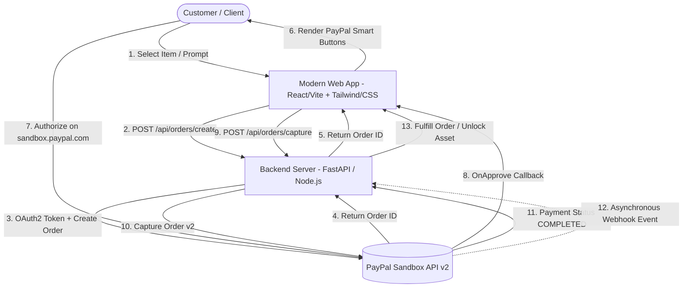

# PayPal Hackathon — Master Blueprint & Execution Plan

---

## 1. Executive Summary & Objective

The goal is to build an impactful, production-grade, and judging-optimized project leveraging **PayPal's Developer APIs & Sandbox Ecosystem** for the hackathon. 

This document outlines:
- **Winning Concept Options** (High-scoring tracks: AI Commerce, Micro-transactions, Escrow/Milestones)
- **PayPal Integration Architecture** (Orders v2, Webhooks, Payouts, Vaulting)
- **Technical Stack & Architecture**
- **Prerequisites & Sandbox Setup Checklist**
- **48-Hour Hackathon Sprint Plan**

---

## 2. Top 3 Winning Project Ideas

### Option A: AgentPay — Autonomous AI Agent Commerce & Micro-Budgeting (Recommended 🏆)
* **Concept:** An autonomous multi-agent assistant that can research, negotiate, and execute purchases or subscriptions on behalf of users within cryptographically signed or pre-authorized budget limits using PayPal.
* **PayPal Features Used:** 
  - PayPal Orders v2 API (Dynamic checkout)
  - PayPal Subscriptions / Vault API (Recurring limits & pre-approvals)
  - Webhooks for payment confirmation & receipt parsing
* **Why Judges Love It:** Combines the biggest trend in tech (AI Agents / Agentic Workflows) with real-world financial rails and guardrails.

### Option B: EscrowFlow — Milestone-Based Freelance / Creator Escrow Platform
* **Concept:** Smart escrow checkout where buyer funds are held or authorized, then conditionally released or captured upon milestone verification, artifact uploads, or dispute-free timers.
* **PayPal Features Used:**
  - PayPal Authorize & Capture (`intent: "AUTHORIZE"` vs `"CAPTURE"`)
  - PayPal Payouts API (Instant disbursement to freelancers/vendors)
  - Dispute & Webhook lifecycle integration
* **Why Judges Love It:** Demonstrates deep mastery of the two-sided marketplace flow (Buyer $\rightarrow$ Platform $\rightarrow$ Seller) using native PayPal primitives.

### Option C: BytePay / StreamSponsor — Dynamic Micro-Billing for APIs & Live Content
* **Concept:** Pay-per-prompt or pay-per-second live streaming patronage / paywall where users can top up or tip via one-click PayPal Smart Payment Buttons with instant real-time feedback.
* **PayPal Features Used:**
  - PayPal JS SDK (`buttons`)
  - PayPal Invoicing API / Instant Receipts
  - Fast Client-to-Server webhook feedback loop

---

### 2.1 Hardware-Backed Biometric Security Gate (Windows Hello / Face ID / PIN)
- **WebAuthn / Passkey Platform Authenticator:** Before any autonomous agent task creates a PayPal order, the system requires hardware-bound biometric authentication (Windows Hello Face Recognition, Fingerprint, or Windows PIN).
- **Cryptographic User Verification:** Generates signed public-key credentials bound to the task ID and transaction amount.
- **Judge Impact:** Proves that agentic autonomous finance can be completely safe, prevent runaway spending, and require physical human presence via hardware biometrics.

## 3. End-to-End System Architecture

---

## 4. PayPal Sandbox Prerequisites & Environment Setup

Follow these steps based on [requisites.md](file:///c:/Users/mohit/OneDrive/Desktop/paypal_hackathon/requisites.md):

1. **Developer Dashboard:**
   - Sign in to [developer.paypal.com/dashboard/accounts](https://developer.paypal.com/dashboard/accounts).
   - Verify your default **Business** (Merchant) and **Personal** (Buyer) sandbox accounts.
   - Note the sandbox email and generated password for both accounts.
2. **App & Credentials:**
   - Go to **Apps & Credentials** $\rightarrow$ Sandbox.
   - Create an app (e.g., `HackathonApp`).
   - Copy `Client ID` and `Client Secret`.
3. **Target Endpoints:**
   - OAuth Token: `POST https://api-m.sandbox.paypal.com/v1/oauth2/token`
   - Create Order: `POST https://api-m.sandbox.paypal.com/v2/checkout/orders`
   - Capture Order: `POST https://api-m.sandbox.paypal.com/v2/checkout/orders/{id}/capture`
   - Webhook Simulator: Set up local tunneling (ngrok / cloudflared) or use PayPal Webhook simulator to test events (`PAYMENT.CAPTURE.COMPLETED`).

---

## 5. Recommended Tech Stack

| Layer | Recommended Choice | Rationale |
|---|---|---|
| **Frontend** | React / Vite + TypeScript + Vanilla/Tailwind CSS | High speed, sleek UI, easy integration with `@paypal/react-paypal-js` |
| **Backend** | Python (FastAPI) or Node.js (Express / Fastify) | Native async, rapid development, lightweight PayPal SDK/HTTP calls |
| **Database** | SQLite (dev) / PostgreSQL (Supabase) | Fast schema iteration for orders, users, transactions, and audit logs |
| **SDK** | `@paypal/react-paypal-js` & direct REST v2 APIs | Official, modern checkout buttons with full popup/modal sandbox support |

---

## 6. Execution Milestones (Sprint Plan)

- [x] **Milestone 1: Environment & Credentials Setup** (Scaffolded backend/.env, test verifier, & documentation)
  - Extract Sandbox Client ID & Secret into `.env`.
  - Validate auth token retrieval via curl/test script.
- [x] **Milestone 2: Backend Core Payments Service** (Orders v2 API client, capture endpoint, guardrail controller, Express)
  - Implement `/api/paypal/create-order` endpoint.
  - Implement `/api/paypal/capture-order` endpoint.
  - Secure credential handling.
- [x] **Milestone 3: Interactive Frontend & Checkout Flow** (React/Vite cockpit, PayPal Smart Buttons, agent presets, audit ledger)
  - Integrate PayPal SDK Smart Button component.
  - Build UI with responsive status toasts, receipt modal, and transaction log.
- [ ] **Milestone 4: Webhook Verification & Lifecycle Management**
  - Setup webhook listener for `PAYMENT.CAPTURE.COMPLETED` and refunds/disputes.
- [ ] **Milestone 5: Hackathon Demo Polish & Pitch Deck**
  - Add sample demo data and one-click test-persona switchers (Buyer vs Seller).
  - Prepare a 2-minute video pitch & architecture diagram walkthrough.

